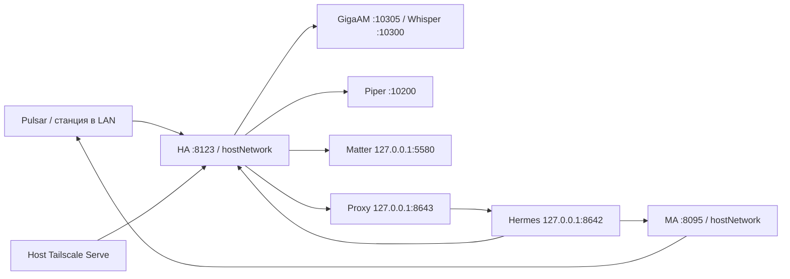

# Миграция неттопа в Kubernetes и observability

Дата исследования: **2026-10-27, около 21:50 (+05)**. Ветка: `develop`,
исходный commit `0644f73`. Статус документа: **исходное исследование и план**. Реализация выполнена
2026-10-27; актуальная эксплуатация и ограничения —
[KUBERNETES-OPERATIONS.md](KUBERNETES-OPERATIONS.md).
IP/имена/пути в публичных примерах обезличены; `192.0.2.0/24` — TEST-NET,
а не реальные адреса для установки. Секреты в этот документ не включаются.

## 1. Решение

Рекомендую **один K3s server/worker на существующей Ubuntu**, со встроенным
containerd, и поэтапный перенос всех прикладных процессов: HA, MA, Matter,
GigaAM, Whisper, Piper, Hermes gateway и voice proxy. Добавить Prometheus,
Grafana, Loki и Alloy. Установка Kubernetes не требует переустановки ОС.

Первый перенос сохраняет **hostNetwork и прежние порты** голосового контура.
Затем можно отдельно переводить подходящие сервисы в pod network. Одновременно
менять оркестратор, сеть, версии приложений, модели и структуры данных нельзя.

Kubernetes здесь даст декларативный deploy, контроль состояния и единый
мониторинг. Один неттоп остаётся единой точкой отказа: control plane,
приложения и local PV пропадают вместе при отказе SSD/питания. Несколько
реплик на том же SSD не превращают систему в отказоустойчивую.

Под «весь неттоп на Kubernetes» здесь понимается перенос **приложений**.
Ubuntu, kernel/DKMS/MOK, netplan/Wi-Fi, systemd, SSH, chrony и аварийный VPN
остаются на хосте. K3s сам запускается systemd. Tailscale на хосте сохраняет
доступ при поломке кластера; его перенос внутрь кластера не является условием
отказа от Docker. Pulsar/BLE gateway физической станции остаются на станции.

## 2. Что исследовано непосредственно

Прочитаны актуальные Compose, `ctl.sh`, HA/Hermes runbooks, inventory,
STATE, проектная структура и правила публикации. Через существующий SSH-доступ
выполнены read-only проверки ОС, памяти, дисков/LVM, сети, listeners,
Docker inspect/stats, systemd, размеров данных и выбранных полей HA storage.
Env просматривался только через whitelist технических параметров; значения
ключей и токенов не выводились. HTTP GET проверял доступность, а не выполнение
голосовых команд. Модельные запросы, воспроизведение, alarm, reload/restart,
установка пакетов, изменение firewall/дисков не выполнялись.

Приватные результаты: `secrets/kubernetes-research/` в локальном checkout.
Они не являются публикуемой диагностикой. Следующие таблицы — снимок этого
исследования, а не замена канонического STATE.

### Хост

| Параметр | Подтверждено live | Следствие |
|---|---|---|
| ОС/kernel | Ubuntu 26.04.1 LTS, `7.0.0-38-generic` | ОС сохраняем; совместимость выбранного K3s проверяем smoke-тестом |
| RAM | 14.85 GiB; доступно около 11.0 GiB в момент проверки | Запас есть, но STT+observability требуют измерения пиков |
| Swap | 4 GiB, включён, использовано 0 | До K3s явно выбрать политику swap; рекомендован первый этап без swap |
| Cgroups | v2 | Базовое требование современного runtime выполнено |
| Root FS | LV 100 GiB, около 57.2 GiB доступно | Свободный NVMe не равен свободному root |
| LVM | около 373.9 GiB не распределено в VG | Есть место для отдельного LV под Kubernetes/telemetry |
| Ethernet | `enp3s0` DOWN, адреса нет | Сейчас нельзя конфигурировать node IP как Ethernet-адрес |
| Wi-Fi | `wlp4s0` UP, реальный рабочий uplink | Node IP/interface должны соответствовать работающему интерфейсу |
| IPv6 | не отключён; на Wi-Fi есть link-local | Сохранить для Matter; глобальный IPv6 не обязателен для link-local |
| Firewall | UFW inactive | При K3s появляются новые listeners, нужна явная матрица доступа |
| Docker | 29.1.3, systemd cgroups, overlayfs | Существующий runtime оставить на период отката |
| Runtime storage | `/var/lib/containerd` около 19.9 GiB | Не оценивать images по маленькому `/var/lib/docker` |
| Kubernetes | K3s/kubectl не обнаружены | Кластер ещё не установлен |
| systemd | failed units не обнаружены | До миграции хост не требует «починки» |

Публичные inventory содержат исторические/примерные значения: Ethernet там
описан статически, но live он отключён; Piper в одном README указан Irina,
а реально запущен Puriso. План опирается на live-снимок, не на эти строки.

### Приложения

| Процесс | Фактически запущено | Сеть/данные | Миграционное условие |
|---|---|---|---|
| HA | `2026.10.4`, privileged | host; `/config`, `/run/dbus:ro`, localtime | Сохранить весь config/.storage/custom_components/SQLite/audio |
| MA | `2.10.8` | host; `/data`; около 644 MiB | Один writer, тот же LAN, Spotify/Sendspin/session state |
| Matter | `matterjs-server:stable` | host; loopback `5580`; `/data`, около 2.1 MiB | Сохранить fabric, IPv6, interface `wlp4s0` |
| GigaAM | `wyoming-onnx-stt:latest` | host `10305`; около 214 MiB; CPU/int8/ru | Сохранить `gigaam-v3-ctc`, warmup и env |
| Whisper | `wyoming-whisper:3.8.1` | host `10300`; около 994 MiB | Сохранить `medium-int8`, ru и initial prompt |
| Piper | `wyoming-piper:2.5.2` | host `10200`; около 121 MiB | `--voice ru_puriso2-medium`, модель/config и Irina для отката |
| Hermes gateway | user systemd, `v0.22.5` | loopback `8642`; `~/.hermes` | Container image на том же revision; auth/state/persona/MCP |
| Voice proxy | user systemd, Python | loopback `8643` | Сохранить SSE sanitizer и low reasoning |

Все шесть контейнеров running, restart count 0 на момент исследования.
В сумме они занимали около 3.14 GiB; Hermes gateway около 337 MiB,
proxy около 13 MiB. Это idle-снимок, не пределы под нагрузкой.
HA/MA/Matter и `/health` обоих Hermes endpoints вернули HTTP 200.
Для всех шести container images доступны RepoDigests: переносить именно
запущенные digests, особенно вместо плавающих `stable`/`latest`.

HA config занимает около 46.7 MiB; общий `nettop/data` около 1.93 GiB;
`~/.hermes` около 2.25 GiB, включая около 886 MiB source checkout.
Не всё содержимое Hermes является пользовательским state: отделить source,
venv/cache от config/auth/sessions/memories до упаковки.

В HA подтверждены Wyoming endpoints `127.0.0.1:10200/10300/10305`,
дополнительный GigaAM endpoint по LAN, MA по LAN и Matter по loopback.
Есть несколько ONNX config entries: **не удалять как «дубли» при миграции**;
сначала установить связь entities/entry_id/pipeline. Активный «Рикардо»:
`stt.onnx_asr` → local intents/Hermes → `tts.piper`, `ru`, Puriso.

## 3. Почему K3s и какие альтернативы рассмотрены

| Вариант | Оценка для этого неттопа |
|---|---|
| **K3s на Ubuntu** | Выбран: сохраняет рабочие драйверы/SSH, встроенный runtime, достаточно для одного узла |
| k0s | Подходит как альтернатива; не даёт решающего преимущества именно этому стеку |
| MicroK8s | Подходит на Ubuntu; отдельная модель snap/add-ons не нужна для выбранного плана |
| kubeadm | Максимальный контроль, но больше самостоятельного сопровождения для одного домашнего узла |
| Talos/bare-metal reinstall | Отложить: затрагивает ОС, vendor Wi-Fi/DKMS, MOK и recovery одновременно с приложениями |
| kind/k3d | Полезны для проверки chart’ов на dev-машине; зависимость от Docker и другая LAN-семантика не отвечают целевой миграции |

Это инженерный выбор для данного хоста, а не универсальный рейтинг.
[K3s requirements](https://docs.k3s.io/installation/requirements),
[k0s requirements](https://docs.k0sproject.io/stable/system-requirements/),
[MicroK8s](https://canonical.com/microk8s/docs/getting-started),
[Talos](https://docs.siderolabs.com/talos/v1.12/getting-started/getting-started).

K3s version выбрать и закрепить **до установки**: поддерживаемый stable patch,
совместимый с pinned Helm charts/CRDs. Не выбирать версию на основании случайного
«latest» в install script. Проверить release notes, checksum и kubeVersion charts.
Сначала обычный single-server SQLite, без внешней БД/etcd-кластера.
Переход к HA control plane — отдельный проект с несколькими физическими узлами.

## 4. Сеть: что сохраняем и что меняем



Первый cutover: у **всех шести** существующих контейнеров `hostNetwork: true`.
Gateway и proxy — два контейнера одного отдельного hostNetwork Pod. Это
сохраняет loopback-контракт без изменения HA integrations, MCP и proxy source.
Не использовать hostPID/hostIPC; HA privileged временно оставить как в baseline,
после переноса отдельно проверить возможность уменьшения привилегий.

MA требует multicast/LAN discovery и обратных соединений со станции;
обычный ClusterIP/Ingress не заменяет эти свойства. Kubernetes deployment
прямо исключён из официальной поддержки MA: мы берём сопровождение на себя.
[MA networking/install](https://www.music-assistant.io/installation/),
[границы поддержки](https://www.music-assistant.io/faq/troubleshooting/).
HA container reference также использует host networking и D-Bus mount:
[официальная установка](https://www.home-assistant.io/installation/linux).

Для hostNetwork Pods — `dnsPolicy: ClusterFirstWithHostNet`; проверить DNS
внешних endpoints и LAN discovery раздельно. При systemd-resolved проверить
kubelet resolv-conf, чтобы pod DNS не получил неработающий loopback stub.
Имя `.local` не считать автоматически разрешаемым через CoreDNS.
[Pod DNS](https://kubernetes.io/docs/concepts/services-networking/dns-pod-service/).

Node IP закрепить на **реальном активном uplink**. Предпочтительно сначала
подключить и отдельно проверить Ethernet, затем выбрать его для K3s. Если
остаёмся на Wi-Fi — зафиксировать этот выбор в private values. Не обещать
автоматический failover Kubernetes между двумя NIC: node-ip, flannel-iface,
Matter PRIMARY_INTERFACE и MA published address требуют согласованности.
Проверку отключения кабеля/Wi-Fi проводить в отдельном окне с аварийным доступом.
[K3s network options](https://docs.k3s.io/networking/basic-network-options).

Matter остаётся hostNetwork с loopback WebSocket, исходным fabric/data и
проверенным PRIMARY_INTERFACE. IPv4-only CNI не требует отключать IPv6 хоста:
link-local IPv6 Matter идёт через host namespace. Не менять интерфейс Matter
одновременно с его контейнерным cutover. [Matter.js server](https://github.com/matter-js/matterjs-server).

Первоначально отключить bundled Traefik и ServiceLB: они не нужны для сохранения
существующего Tailscale Serve, а ServiceLB/Traefik могут занимать 80/443.
CoreDNS и metrics-server оставить. Flannel оставить стандартный, без Cilium,
Multus/MetalLB на первом этапе. Pod/service CIDR выбрать после проверки routes
Docker, LAN и VPN; обычные `10.42.0.0/16`/`10.43.0.0/16` — только кандидаты.
[K3s networking services](https://docs.k3s.io/networking/networking-services).

| Доступ | Политика первого этапа |
|---|---|
| HA `8123`, MA `8095/8097/8927`, discovery | Сохранить текущую LAN-доступность и необходимые динамические audio ports |
| Piper/Whisper/GigaAM | Сохранить текущие bind/ports до отдельной сетевой оптимизации |
| Matter `5580`, Hermes `8642/8643` | Только loopback; проверить после cutover, не ослаблять ради readiness probe |
| Kubernetes API `6443`, kubelet `10250` | Закрыть от интернета и обычных клиентов; администрирование через SSH/ограниченный admin-доступ |
| Flannel VXLAN `8472/udp` | Не публиковать; разрешать только при необходимости между cluster nodes |
| Grafana | ClusterIP + SSH port-forward; позднее отдельный закрытый Tailscale Serve endpoint |
| Prometheus/Loki/Alertmanager | Только внутри кластера/администраторский port-forward |

Не включать UFW наугад во время удалённой установки: сначала сохранить rules,
прописать SSH/Tailscale/CNI allow-path и проверить аварийный доступ.
NetworkPolicy не считать достаточной изоляцией hostNetwork Pods; здесь важны
host firewall и bind addresses. [Kubernetes NetworkPolicy](https://kubernetes.io/docs/concepts/services-networking/network-policies/).

## 5. Диски, state и rollback

С observability рекомендую **новый LV около 150 GiB**, mount `/srv/k3s`:
`/srv/k3s/runtime` для K3s data-dir, `/srv/k3s/volumes` для новых PV.
Это использует часть свободного VG и отделяет рост images/логов от root.
Пользователь подтвердил, что свободные примерно 400 GB можно выделить под
миграцию. Live `vgs` показывает около 374 GiB уже внутри VG: достаточно
создать LV, а не переразмечать GPT/существующие разделы. После выделения
150 GiB останется примерно 224 GiB VG для расширения/других данных.
Точный размер согласовать с реальным retention и запасом VG; здесь это бюджет,
а не уже созданный диск. Не переустанавливать ОС и не расширять root вслепую.

Для существующих HA/MA/Matter/model данных первый cutover использует прежние
каталоги через **static local PV + PVC**, nodeAffinity и reclaimPolicy `Retain`.
Имя пути/узла — только private deployment values. Не создавать пустой каталог
вместо отсутствующего source. Для вспомогательных host mounts проверять тип.
Для новых observability PVC — отдельные static local PV на новом LV, тот же
Retain. Не использовать default удаление local-path volume как backup policy.
[Local volumes](https://kubernetes.io/docs/concepts/storage/volumes/#local).

Один workload с SQLite/state — **одна replica, Deployment Recreate** и ожидание
реального завершения старого процесса. RWO не гарантирует одного writer на
одном узле. Нельзя запускать Docker и Kubernetes одновременно на одном data-dir;
не делать force delete Pod при неясном состоянии процесса.
[Deployment lifecycle](https://kubernetes.io/docs/concepts/workloads/controllers/deployment/).

Порядок на каждый сервис: preliminary backup → остановка Docker service →
проверка освобождения порта/отсутствия writer → согласованный финальный backup →
запуск Kubernetes → проверки. `docker update --restart=no` для старого контейнера
выполнить в этом окне и записать исходную policy: иначе Docker может поднять его
после reboot одновременно с Pod. Исключить также systemd/cron/старый ctl autostart.

HA backup включает весь `/config`, `.storage`, БД с WAL/SHM, media/www,
custom_components, SSH/ключи интеграций и secrets.yaml. MA — БД/провайдеры/Spotify
credentials/queues. Matter — весь fabric; модели — веса+JSON+хеши; Hermes —
config/auth/.env/session DB/memories/persona. Простое копирование работающего
SQLite `.db` без WAL не считается согласованным backup.

**Откат:** остановить Kubernetes workload и дождаться завершения Pod, убедиться
в отсутствии writer, затем запустить прежний Docker container с тем же pinned
image и данными. При одинаковой версии приложения можно сохранить новые записи.
Cold backup восстанавливать только при повреждении/несовместимости, после
сохранения текущей копии; это может потерять записи после backup. Helm rollback
меняет манифесты, но не откатывает данные или схемы БД.

Backup кластера отдельно от backup приложений: для выбранного SQLite сохранить
согласованную копию server/db, server token и конфигурации/ключей encryption
в закрытом backup. `k3s etcd-snapshot` не является backup SQLite и не включает
прикладные PV. Проверять восстановление на тестовой копии.
[K3s backup/restore](https://docs.k3s.io/datastore/backup-restore).

## 6. Hermes: отдельный этап контейнеризации

Live gateway: **v0.22.5, commit `bf0203a794a07aac3ff764972ab9087baa4e4f4e`**,
checkout чистый, Python 3.14.9. Сейчас systemd запускает gateway из venv под
source checkout; копирование этого venv в произвольный image ненадёжно.

До cutover собрать/найти image **того же revision**, закрепить digest и
dependency lock. Текущая официальная контейнеризация Hermes существует, но её
latest image может иметь другой config/runtime lifecycle и миграции. Проверить
совместимость именно v0.22.5; нельзя незаметно обновить Hermes ради Dockerfile.
[Официальный Docker guide](https://hermes-agent.nousresearch.com/docs/user-guide/docker).

Gateway и proxy помещаются в один Pod, два контейнера, hostNetwork, loopback
`8642/8643`. Proxy image содержит текущий проверенный `voice_proxy.py`.
Kubernetes управляет рестартами; запуск user systemd внутри image не нужен.
EntryPoint/s6 конкретного upstream image проверить при packaging.

State монтировать отдельно от исходников/venv: проверить реальный layout auth,
HOME/HERMES_HOME, права UID/GID и возможные ссылки на абсолютные host paths.
Refreshable auth state должен быть writable на PVC: Kubernetes Secret не
заменяет файлы, которые приложение само обновляет. Статические API/MCP ключи
передавать отдельно через Secret/секретный файл. Не монтировать весь host home,
Docker socket или kubeconfig. Сохранить намеренно выбранные права HA/MA MCP.

Изолированный packaging-test возможен на **копии** state и альтернативных портах,
без доступа к управляющим HA/MA endpoints и без модельного запроса по умолчанию.
Не запускать два агента с общими refreshable credentials одновременно.
Финальный cutover останавливает два user units и блокирует их autostart на время
rollback; затем запускает один Pod. Сохранить streaming sanitizer, persona,
voice low reasoning и local-intent приоритет. Не менять модель в этом этапе.

## 7. Prometheus, Loki, Grafana и Alloy

### Состав и размер

| Компонент | Deploy | Начальный budget/данные |
|---|---|---|
| Prometheus Operator + Prometheus | pinned `kube-prometheus-stack` | 1 replica; 20 GiB PVC; 7d, size retention около 12 GiB |
| Grafana | из того же stack, один instance | 2 GiB PVC; datasources/dashboards из Git |
| Alertmanager | из stack | 1 replica; 1 GiB PVC; внешние уведомления отдельно |
| kube-state-metrics + node-exporter | из stack | pod/cluster/host metrics |
| Loki | community Helm chart, monolithic | 1 replica; 20 GiB PVC; TSDB/filesystem, replication factor 1 |
| Grafana Alloy | официальный Helm chart, DaemonSet | один агент на этом узле, positions/state persistent около 1 GiB |
| Blackbox exporter | отдельный release/конфиг | HTTP/TCP checks; отдельная политика для loopback targets |

Это проектные начальные значения, не измеренное потребление будущего стека.
Для observability зарезервировать примерно 2 GiB memory requests и 3–4 GiB
на пики; для K3s+host оставить 2–3 GiB, приложениям — остальное. Перед
утверждением limits измерить пики STT, TTS, MA и тяжёлого Grafana query вместе.
Не ставить жёсткий низкий CPU limit на STT: throttling ухудшит задержку.
Сумма defaults чужих charts без настройки не является capacity plan.
[Resource requests/limits](https://kubernetes.io/docs/concepts/configuration/manage-resources-containers/).

Не добавлять пока Thanos/Mimir, distributed Loki, MinIO/Longhorn/Ceph или service
mesh. Для одного узла они увеличивают процессы и число отказов без резервирования
железа. При росте до нескольких узлов пересмотреть storage/object storage.

Prometheus retention по времени **и размеру**; диск нужен также WAL/head и
операциям compaction. Начать scrape 30s для cluster/host, 15s только для нужных
app metrics. Отдельно ограничить high-cardinality series.
[Prometheus storage](https://prometheus.io/docs/prometheus/latest/storage/).

Loki: явный monolithic mode, 1 replica, локальный filesystem и включённый
Compactor retention, сначала **7 дней**. `retention_period` без реально
включённого retention недостаточен. Измерить объём/сутки и настроить ingestion/
query limits; старение по времени не защищает диск от резкого потока логов.
Alert на заполнение LV/PVC, ограничение CRI container logs на kubelet отдельно.
[Monolithic install](https://grafana.com/docs/loki/latest/setup/install/helm/install-monolithic/),
[retention](https://grafana.com/docs/loki/latest/operations/storage/retention/).

В актуальной Loki-документации chart перенесён в **Grafana-community**;
с chart 12 используется название `Monolithic`, старое `SingleBinary` deprecated.
Поэтому не копировать values из старого tutorial: pinned chart version,
его schema и `helm template` определяют реальные keys.

Логи собирает **Alloy**, не Promtail: Promtail EOL 2026-03-02.
[Alloy install](https://grafana.com/docs/alloy/latest/set-up/install/kubernetes/),
[Promtail EOL](https://grafana.com/docs/alloy/latest/set-up/migrate/from-promtail/).
Предпочтителен node-local CRI file collection с persistent positions, чтением
`/var/log/pods` read-only и фильтрацией до отправки. Journal хоста при необходимости
читать отдельно с allowlist units `k3s`/runtime и ограниченными правами.
Никакого рекурсивного сбора `~/.hermes`, HA `.storage` или secrets directories.

### Как дашборды из папок проекта попадут в Grafana

**Один Grafana для кластера, project-owned dashboard charts.** Дашборды
попадают в Pod Grafana через ConfigMaps и dashboard sidecar; имена Pod не
фиксируются и не участвуют в deploy. Каждый проект владеет JSON и своим
небольшим chart; домашняя композиция выбирает releases и overrides.

Предлагаемая структура (пока план, эти chart’ы ещё не созданы):

```text
platform/observability/
  charts/cluster-dashboards/
    Chart.yaml
    dashboards/node.json
    dashboards/kubernetes.json
    templates/dashboards.yaml
  values/kube-prometheus-stack.yaml
  values/loki.yaml
  values/alloy.yaml

projects/home-assistant/
  deploy/chart/                        HA/MA/Matter/STT/TTS/Hermes workloads
  observability/chart/
    Chart.yaml
    values.yaml
    dashboards/home-assistant.json
    dashboards/voice-pipeline.json
    dashboards/music-assistant.json
    templates/dashboards.yaml
    templates/servicemonitors.yaml
    templates/prometheusrules.yaml

solutions/alarm/observability/chart/    только когда появятся реальные metrics
projects/home/kubernetes/
  helmfile.yaml                        composition + pinned release versions
  values/public.example.yaml
  README.md
```

Реальные host paths/IP, credentials, auth и deployment overrides — только
`secrets/`; tracked values содержат безопасные defaults/TEST-NET examples.
Project-specific manifests не помещать в переиспользуемые solutions.
Helmfile удобен для нескольких releases; его версию/lock тоже закрепить.
Если не вводить Helmfile, тот же release list выполняет project deploy script.

Важное ограничение Helm: `.Files` видит файлы **внутри своего chart package**,
не соседние директории и не `../../` вне chart. Поэтому dashboard JSON лежит
в `observability/chart/dashboards/`; это по-прежнему папка соответствующего
проекта. Общий umbrella chart не должен пытаться прочитать их напрямую.
[Helm file access](https://helm.sh/docs/chart_template_guide/accessing_files/).

Каждый dashboard chart создаёт по одному ConfigMap на JSON в namespace
`monitoring`, label `grafana_dashboard: "1"`, annotation `grafana_folder` для
папки проекта. Chart устанавливается отдельным release в `monitoring` даже
если прикладные Pods проекта находятся в `home-assistant`. Не создавать
сам namespace monitoring из каждого chart.

Пример контракта rendering, не готовый deploy manifest:

```yaml
apiVersion: v1
kind: ConfigMap
metadata:
  name: ha-voice-dashboard
  namespace: monitoring
  labels:
    grafana_dashboard: "1"
  annotations:
    grafana_folder: /tmp/dashboards/Home Assistant
# data.voice-pipeline.json содержит содержимое JSON из chart/dashboards/
```

Sidecar Grafana watches только `monitoring`, только этот label; provider
`foldersFromFilesStructure: true`, `folderAnnotation: grafana_folder`,
`allowUiUpdates: false`. Datasource UIDs стабильны: `prometheus` и `loki`.
Dashboard UID стабилен и уникален глобально: например `ha-voice-pipeline`.
JSON вставляется как файл, без `tpl` над Grafana expressions.
[Stack values](https://github.com/prometheus-community/helm-charts/blob/main/charts/kube-prometheus-stack/values.yaml),
[Grafana provisioning](https://grafana.com/docs/grafana/latest/administration/provisioning/).

Доставка: commit JSON → lint/render chart → Helm upgrade dashboard release →
ConfigMap update → sidecar writes JSON → Grafana provisioning refresh.
Не требуется ручной import, `kubectl cp` или перезапуск всего Grafana. После
пересоздания Pod дашборды восстанавливаются из ConfigMaps. UI используется для
экспериментов на копии dashboard; принятая версия экспортируется в Git.
Удаление dashboard из Git должно иметь определённую политику удаления в
provisioner; проверить её на тестовом dashboard, а не оставлять stale копии.

Размер каждого ConfigMap и Helm release ограничен: не складывать сотни JSON
в один ресурс. Проверять rendered size, UID collisions, JSON validity и отсутствие
embedded credentials. Не скачивать дашборды по numeric ID во время старта Pod;
нужные upstream JSON vendor’ить с лицензией/происхождением или генерировать
пинованным инструментом при build. Никаких секретов в dashboard variables.

### Метрики и дашборды первого этапа

1. **Nettop:** RAM/available, CPU/load/pressure, SSD/root/LV space, IO latency,
   filesystem inode pressure, сеть и link state, systemd/K3s availability.
2. **Kubernetes:** Pending/NotReady/restarts/OOM, requests vs allocatable,
   PVC capacity, CRI log growth, control-plane availability.
3. **HA:** availability, recorder/state storage, integration errors,
   pipeline operational state. Если включаем HA Prometheus integration,
   whitelist entities и Secret для bearer token; не экспортировать домашние
   состояния целиком по умолчанию.
4. **Voice:** доступность 10200/10300/10305/8642/8643, STT/TTS/LLM latency,
   errors и fallback. Latency возможна только при реальной instrumentation:
   сегодня наличие native `/metrics` у этих процессов не подтверждено.
   TCP probe показывает порт, но не качество распознавания/синтеза.
5. **Music:** MA/Sendspin availability, рестарты и error logs, сетевые сбои.
   Специальные playback counters добавлять только после проверки exporter/API.
6. **Logs:** панели Loki по namespace/workload/severity без текстов разговоров.

Prometheus Operator должен выбирать ServiceMonitor/PrometheusRule наших chart’ов:
release labels и namespace selectors закрепить в values. CRDs установить раньше
проектных monitors/rules; обновлять CRDs по инструкции pinned stack, не полагаться
на автоматический Helm rollback CRD. Для K3s отключить неприменимые default
etcd/control-plane scrape jobs/alerts или настроить реально доступные endpoints:
не открывать host metrics всему LAN ради зелёной панели.

Loopback endpoints недоступны blackbox Pod в обычной сети. Нужен выделенный
hostNetwork prober или минимальный hostNetwork exporter, либо локальные
exec probes. Не менять `127.0.0.1` на `0.0.0.0` ради мониторинга. TCP/exec startup
и readiness для loopback-сервисов должны проверять именно текущий Pod/process,
а не случайно продолжающий работать Docker container на том же порту.

### Логи и доступ

Alloy allowlist workloads; drop/redact Authorization, cookies, tokens и URL query
credentials **до** Loki. Voice/STT/LLM transcripts, full request/response bodies,
prompt и HA entity private state не собирать по умолчанию. Redaction regex не
гарантирует удаления свободного текста: при сомнении исключать источник.
Label cardinality: cluster/namespace/workload/container/severity; не добавлять
request_id/user_id/transcript/полный URL как labels. Проверить фильтрацию на
синтетических токенах до допуска реальных логов.

Grafana admin credentials через существующий Secret, auth включён; anonymous
и sign-up выключены. Loki не имеет встроенного auth layer, поэтому его Service
не публикуется наружу. [Loki installation/security boundary](https://grafana.com/docs/loki/latest/setup/install/).

Первый доступ к Grafana — SSH + port-forward. Затем отдельный закрытый endpoint
Tailscale с проверкой ACL; текущий HA Serve route не перезаписывать. Prometheus,
Loki и Alertmanager не выставлять в LAN как открытые NodePorts.

Начальные alerts: NodeNotReady, pod crash/OOM, disk <20% и <10%, PVC рост,
HA/MA/voice endpoint down, Prometheus target down, Loki ingestion/compactor errors,
backup freshness. Уведомления сначала видны в Alertmanager/Grafana; канал наружу
и его secrets — отдельная настройка. Внешний heartbeat нужен отдельно: лежащий
неттоп не сможет сам отправить alert о полном отключении питания.

## 8. Порядок миграции, критерии перехода и простой

Времена ниже — ориентиры планирования для одного исполнителя, не обещание SLA.
Не делать cutover во время активного будильника/таймера/воспроизведения.

| Этап | Действия | Gate | Планируемый impact |
|---|---|---|---|
| 0. Зафиксировать baseline | digests/версии, private paths/env, config entries, backup, модельные хеши, autostart owners | Приватный manifest, проверенная копия вне неттопа, понятен откат | Без простоя; несколько часов |
| 1. Хост и сеть | Выбрать uplink/node IP; подготовить LV; swap policy; ports/CIDR; pin K3s | SSH/VPN живы, disk mount постоянный, правила не блокируют текущий стек | Окно обслуживания для сетевых изменений; установка ~0.5 дня |
| 2. Пустой K3s | containerd, CoreDNS, metrics-server; Traefik/ServiceLB off; secrets encryption | Node Ready, DNS/egress/PVC smoke, Docker workloads не деградируют | Сам installer меняет networking; наблюдать текущий audio/HA |
| 3. Observability | Prometheus/Grafana/Loki/Alloy, dashboard charts, CRDs/selectors | Дашборд из Git появился, synthetic redaction работает, disk/RAM в бюджете | Без cutover приложений; ~0.5–1 день |
| 4. Whisper | Остановить Docker Whisper, cold backup, Pod на тех же данных/10300 | Процесс готов, Wyoming handshake, fallback с отдельным тестом | Fallback недоступен ориентировочно 5–15 мин |
| 5. Piper | Аналогично, сохранить Puriso/Irina | voices/streaming, HA TTS и endpoint | TTS окно 5–15 мин |
| 6. GigaAM | Сохранить env/model, warmup, 10305 | readiness после загрузки модели; STT «Рикардо» | Основной голос недоступен 5–15 мин |
| 7. Matter | Старый instance off, тот же fabric/5580/interface | HA reconnect, commissioned devices работают, fabric не создан заново | Matter окно 5–15 мин |
| 8. MA | pinned 2.10.8, тот же data/LAN/published IP | Spotify search/play, Sendspin, queue/source/duck/resume | Музыка 10–20 мин |
| 9. HA | `2026.10.4`, один writer, /config и host mounts | UI/API + Tailscale + integrations, alarms/schedules сохранены | HA/автоматика 10–20 мин |
| 10. Hermes/proxy | Контейнеризация проверена; user units off, Pod on | health, auth refresh, HA/MA MCP, persona, SSE/low reasoning | Свободная речь 10–20 мин; local intents отдельно |
| 11. Soak | 48–72 ч; planned restart/reboot и restore rehearsal | Нет регрессий/двойного autostart/роста памяти/диска | Один согласованный reboot после стабилизации |
| 12. Docker retirement | Старые container policies off, архив конфигов/images, runtime dependency audit | Нет workloads/cron/tools, которым нужен dockerd | Docker остановить, затем позже удалить пакеты |

Маленькие cutover можно объединить в несколько удобных окон, но каждое должно
иметь отдельный gate и откат. Если после первого K3s networking smoke потерян
SSH/HA/MA — не продолжать перенос приложений, сначала восстановить baseline.

Установка/упаковка/проверки суммарно ориентировочно **3–5 рабочих дней** плюс
48–72 часа наблюдения. Hermes packaging, сеть и restore rehearsal могут увеличить
срок. Нулевого простоя на одном узле при сохранении host ports не обещаем.

Образ K3s config для последующей реализации, **не запускался**:

```yaml
# /etc/rancher/k3s/config.yaml — реальные адреса только в private copy
node-name: lab-host
node-ip: 192.0.2.25
flannel-iface: wlp4s0
cluster-cidr: 10.42.0.0/16
service-cidr: 10.43.0.0/16
data-dir: /srv/k3s/runtime
write-kubeconfig-mode: "0600"
secrets-encryption: true
disable:
  - traefik
  - servicelb
```

Параметры и syntax подтвердить для pinned версии. До первого старта решить
swap: рекомендованно отключить текущий неиспользуемый swap и убрать autostart
с сохранённым rollback; альтернатива — явная поддерживаемая kubelet swap config,
а не обход ошибки неизвестными flags. [Swap management](https://kubernetes.io/docs/concepts/cluster-administration/swap-memory-management/).
[K3s configuration](https://docs.k3s.io/installation/configuration),
[server flags](https://docs.k3s.io/cli/server),
[secrets encryption](https://docs.k3s.io/security/secrets-encryption).

Startup probe должна терпеть загрузку ASR/TTS; liveness проверяет процесс,
а не доступность Spotify/OpenAI. Readiness может учитывать зависимости, но не
должна запускать реальные разговоры/звук. Graceful termination 60–120 секунд
уточнить по сервисам. Не использовать aggressive restart loop вместо диагностики.

При удалении Docker помнить: текущий containerd может принадлежать Docker,
а K3s использует собственный. Проверить пути сокетов/binaries и ownership
пакетов; не удалять `/var/lib/containerd`/images или shared dependencies вслепую.
Удаление старых images/data — отдельный шаг после срока rollback, не условие
успешной миграции.

## 9. Приёмка

### Перед каждым cutover

- Есть backup и его checksum; на внешней машине проверено чтение/распаковка.
- Старый image digest доступен локально или в registry; новые модели не скачиваются в outage.
- Не активны alarm/timer/music и нет параллельных изменений другого чата.
- Понятно, кто владеет данными/портом; старый autostart отключён.
- Helm render/validation/секретный аудит пройдены; реальные значения не в Git.

### После всей миграции

- Все восемь прикладных процессов под Kubernetes; `docker ps` пуст,
  два Hermes user units не запускаются сами.
- После planned Pod restart/reboot данные и endpoints восстановились.
- HA UI/API доступны по LAN и существующему Tailscale URL.
- Pulsar остаётся той же сборки; wake «Рикардо», mute/pre-roll не затронуты.
- GigaAM primary/Whisper fallback, Puriso, local intents, Hermes fallback работают.
- SSE сохранился; reasoning/URL не произносятся; persona прежняя.
- Spotify/MA/Sendspin, громкость, duck/resume, alarm/snooze/stop и schedules
  проверены в согласованном сценарии с восстановлением состояния.
- Matter integration/fabric/device identities сохранены; при отсутствии paired
  devices честно зафиксировано, что проверены только server/reconnect.
- Grafana после удаления/пересоздания Pod сама загружает dashboard из chart;
  изменение JSON + Helm upgrade меняет нужную панель без ручного import.
- Prometheus targets/rules видны, Loki получает отфильтрованные логи,
  retention действительно работает; тестовые secret markers не обнаруживаются.
- При полной потере кластера SSH/Tailscale доступны, restore проверен отдельно.

## 10. Что должно появиться в реализации

1. Пинованный host bootstrap (например Ansible) для K3s/LV/mount/network checks;
   без попытки заменить host services на прикладные Pods.
2. Chart workload’ов `projects/home-assistant/deploy/chart` с private overrides,
   PVCs/host mounts/probes/resources и явным single-instance lifecycle.
3. Пинованные images Hermes/proxy с воспроизводимой сборкой и state migration notes.
4. Observability values + project/cluster dashboard charts + deployment composition.
5. Co-located проверки chart’ов: Helm lint/template, schema validation, JSON UID,
   label/selector contract, forbidden public listeners, synthetic log redaction.
6. Расширение project E2E для Kubernetes, без неявного включения audio/mutations.
7. Новый ops entrypoint и backup/restore runbook; `ctl.sh` остаётся Docker rollback
   tool на переходный период, а не молча меняет backend текущих команд.
8. Документация STATE/OPERATIONS/REBUILD обновляется **после фактического deploy**.

Первый практический milestone: подготовленный K3s + observability + один
некритичный перенесённый сервис, с доказанным возвратом в Docker. После этого
масштабировать тот же проверенный процесс на оставшиеся workloads.
