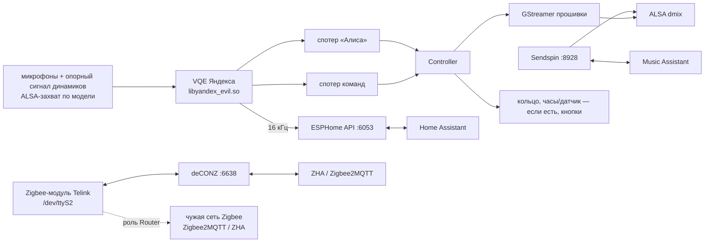

# Архитектура демона

Здесь — устройство кода в `satellite/`, которое из одного файла не видно: workspace, нормативная
модель исполнения для всех крейтов, плавающая точка, линковка sendspin-cpp, формат `state.conf`
для отката на `.prev`, порты. Здесь нет поведения отдельных сервисов и железа: поведение кода — в
коде, обоснования — в комментариях у кода; модели и библиотеки прошивки — [hardware.md](hardware.md),
голос и арбитраж — [voice.md](voice.md), Zigbee — [zigbee.md](zigbee.md), сборка, установка и
релизы — [development.md](development.md).

## Workspace

`satellite/` — крейты Pulsar; манифесты, `Cargo.lock` (коммитится; сборка, clippy и тесты
идут с `--locked`) и `rust-toolchain.toml` — общие, в корне монорепозитория (`/Cargo.toml`,
`/rust-toolchain.toml`). Сборка, fmt/clippy/тесты и кросс-сборки — Bazel (`BUILD.bazel` в
`satellite/` и `crates/*`, toolchain, `@crates//` и C/C++ — в корневом `MODULE.bazel`).

| Крейт | Ответственность |
|---|---|
| `pulsar` | демон: рантайм и завершение (`main.rs`), контроллер — вся логика сателлита, `state.conf`, отчёт о падении |
| `pulsar-core` | общие части: слои `tracing` (stderr-контракт и ESPHome-sink), супервизор акторов, таймеры, громкость, мелкие общие типы |
| `pulsar-model` | описание железа модели: `DeviceProfile` из capability-структур (`Identity`, `Audio`, `VolumeCurve`, `Leds`, `Option<ClockPanel>`, `Input`, `Option<LightSensor>`, `Option<ZigbeeRadio>`, `Earcons`, `Option<Preroll>`) и детект по devicetree / `quasar.cfg` |
| `pulsar-alsa` | libasound прошивки, загружаемая через dlopen; обёртки PCM / ctl |
| `pulsar-esphome` | сервер ESPHome Native API (plaintext / Noise) |
| `pulsar-mdns` | mDNS-респондер: чистое DNS-ядро и UDP/rtnetlink-адаптер |
| `pulsar-arbiter` | арбитр wake word между станциями: протокол, стратегия и UDP-актор |
| `pulsar-audio` | микрофонный фронтенд (захват → VQE Яндекса → спотеры → поток 16 кГц) и музыкальные признаки опорного сигнала динамика |
| `pulsar-media` | воспроизведение через GStreamer прошивки (каналы Music / Announce) и `Mixer` |
| `pulsar-sendspin` | Sendspin-плеер на sendspin-cpp через C-шим `shim/` (см. [«Линковка C++ (sendspin-cpp)»](#линковка-c-sendspin-cpp)) |
| `pulsar-ui` | чистый домен интерфейса: рендер эффектов LED, анимации и шрифт часов, композиция слоёв обоих устройств, доменные типы (`Effect`, `MusicStyle`, `ClockFace`), общий `MusicSource` |
| `pulsar-hw` | актор кольца LED / логотипа, sysfs/fb/i2c и кнопки; рендер — в `pulsar-ui` |
| `pulsar-clock` | актор часов, sysfs-вывод и датчик освещённости; слои и анимации — в `pulsar-ui` |
| `pulsar-zigbee` | радио Zigbee Миди: роли и прошивка радио; внутренний API — в `//!` `src/lib.rs` |
| `pulsar-update` | бэкенд сущности обновления «Firmware» в HA |

Общие примитивы с другими программами монорепозитория живут в `packages/rust/`:
`home-runtime` (Supervisor), `home-actor` (Handle/channel), `home-telemetry`
(bootstrap `tracing`), `home-linux` (errno и запись sysfs). Крейт Pulsar их только использует.

`third_party/` — только сборка sendspin-cpp.

Утилиты — `crates/<крейт>/src/bin/<имя>.rs`; аргументы — в `//!` каждой утилиты.

| Утилита | Назначение |
|---|---|
| `alsa_abi_probe` | ABI hw-params alsa-lib на PCM `null`, без звука |
| `api_selftest` | API-сервер с печатающими обработчиками для внешнего клиента |
| `lan_probe` | проверки mDNS и арбитража на альтернативных портах рядом с демоном |
| `ww_offline` | офлайн-прогон стокового спотера по записи захвата |
| `frontend_probe` | микрофонный фронтенд без демона: события, частоты, запись сырого захвата |
| `player_probe` | сценарии плеера и `Mixer` на ограниченной громкости |
| `sendspin_probe` | Sendspin-плеер без демона, для `tools/sendspin_server.py` |
| `hw_probe` | LED, часы, кнопки, датчик освещённости |
| `update_probe` | HTTPS-клиент и апдейтер без демона |
| `zigbee_probe` | радио Миди без демона: координатор с сервером deCONZ, идентификация и запись прошивки |

### Потоки данных

Схема демона; число микрофонов, PCM захвата и его частота зависят от модели (раздел «Звук» docs
моделей, указатель — [hardware.md, «Модели»](hardware.md#модели)).

## Модель исполнения

Нормативно для всех крейтов; код ссылается на номера пунктов.

1. В процессе один рантайм tokio `current_thread` и `LocalSet`. Все асинхронные задачи
   порождаются через `pulsar_core::supervisor().spawn_local(...)` — общий
   `home_runtime::Supervisor` (по одному на поток) над `TaskTracker` +
   `CancellationToken`, который в конце
   останавливает акторов и возвращает имена не завершившихся. `tokio::spawn` не используется
   (`tokio::task::spawn_blocking` этим правилом не запрещён; блокирующие циклы — п. 4).
   Серверы вне станции берут тот же `Supervisor::spawn` для `Send`-задач.
2. Каждый сервис устроен одинаково:
   - `pub fn spawn(cfg…) -> (XHandle, UnboundedReceiver<XEvent>)`; сервис без событий возвращает
     только handle.
   - Синхронное открытие ресурсов (bind, open, dlopen) — внутри `spawn`. При ошибке: если
     контроллер продолжает пользоваться объектом, `spawn` логирует ошибку и возвращает
     деградированный handle (команды принимаются, вывода нет); если контроллер без него
     обходится — `spawn` возвращает `Result<_, String>`.
   - `XHandle`: `Clone`, все методы принимают `&self`, не `async` и никогда не блокируют. Команды
     уходят в `tokio::sync::mpsc::UnboundedSender<Cmd>` и обрабатываются актором в порядке FIFO.
     Геттеры читают разделяемое состояние, которое актор (или рабочий поток) обновляет до отправки
     соответствующего события.
   - Все handle живут в `LocalSet` контроллера и могут быть `!Send`. Поля, которые пишут только на
     потоке рантайма (handle и актор), — `Rc<Cell>` / `Rc<RefCell>`; borrow не держится через
     `.await` и не уходит в FFI-колбэки. Поля, которые пишет `std::thread`, — `Arc` + атомики;
     `Relaxed` достаточно, порядок относительно события задаёт канал.
   - Поле, которое пишет handle, существует в одном экземпляре, в общей ячейке: актор читает и
     меняет его на месте, не держит копию и не публикует как снимок.
   - Сразу после команды геттер, как правило, отдаёт прежнее значение: состояние меняет актор или
     рабочий поток. Если геттер синхронный (значение задаёт сам handle-метод или `spawn`), это
     сказано в его `///`.
   - События идут через `tokio::sync::mpsc::UnboundedReceiver<XEvent>`. Контроллер сам владеет
     своим состоянием и выбирает события через `tokio::select!`; реентрантных вызовов нет.
   - Ответ на запрос, который можно отменить или вытеснить (воспроизведение, арбитраж, голосовой
     run), несёт id, возвращённый методом handle (например, `PlayId`); устаревшие id контроллер
     игнорирует. У проверки и установки обновлений id только связывает ответ с запросом.
3. Таймеры внутри актора — `pulsar_core::Timers<K>` (ключ — enum актора); порядок срабатывания
   описан в `//!` `pulsar-core/src/timers.rs`. Ключи одного снимка срабатывают подряд, без других
   событий между ними, только если `timers.next()` — первая ветка `tokio::select!` с `biased;`.
4. Блокирующие и реалтайм-циклы — отдельные именованные `std::thread` (захват и VQE, главный цикл
   GLib, писатель ANNOUNCE и его чтение url, запись прошивки радио; по тем же правилам — колбэк
   sink на потоке sendspin-cpp). Наружу они отправляют данные через `UnboundedSender`, команды
   получают через атомики, `Mutex` или `std::sync::mpsc`.
5. Актор завершается, когда закрыт его канал команд (все handle уничтожены), и при выходе
   убирает за собой. Общий примитив — `home_actor::Handle<C>`: `send(&self, C)` не
   блокирует, канал закрывается после последнего handle. Потоки
   останавливаются в `Drop` своего владельца (флаг + join); исключения описаны у кода.
6. Не держать `RefCell`-borrow через `.await`. Состояние актора хранится по значению в его задаче.
7. Логи пишутся через `tracing::{debug,info,warn,error}!`. Бэкенд — слой `pulsar-core` поверх
   `home-telemetry`: сохраняет C++-формат stderr `HH:MM:SS.mmm L file:line msg` (обрезка
   1023 байта, склейка повторов раз в 30 с) и ESPHome-sink `[W][file.rs:12]: msg`; записи
   сторонних крейтов через `log` приходят мостом `tracing-log`. Утилита, чей крейт-бинарь назван
   не `pulsar*`, вызывает `pulsar_core::add_own_target(module_path!())` (рядом с
   `init_logger()`, порядок не важен), иначе её записи считаются чужими.
8. `unsafe` и все вызовы `libc` (включая `std::env::set_var`) живут только в модулях
   `sys.rs` / `ffi.rs` (в `pulsar-media` таким же FFI-модулем служит `gst.rs`),
   `pulsar-core/src/compat.rs`, `packages/rust/home-linux` (sysfs `pwrite`) и в обработчике
   крашей.
   - В каждом крейте `#![deny(unsafe_op_in_unsafe_fn)]`, у каждого блока `unsafe` — комментарий
     `// SAFETY:`.
   - Символы dlopen резолвятся один раз в структуру указателей на функции.
   - Раскладки C-структур — `#[repr(C)]` с compile-time `assert!(core::mem::offset_of!(…) == …)`
     под `#[cfg(target_arch)]`.
9. Комментарии в коде — [AGENTS.md, «Правила кода»](../AGENTS.md#правила-кода).
10. Должен проходить `bazel test //projects/station/pulsar/satellite/...` (fmt, clippy, тесты).

## Плавающая точка (FMA)

- Rust сам никогда не сливает умножение со сложением. Там, где важно побитовое совпадение со
  станционной сборкой (пороги, округление до целого, гистерезис, решение о бите), `a + b*c`
  записано как `mul_add` — одно округление вместо двух; результат может отличаться от раздельных
  операций на 1–2 ulp. У такого места — комментарий с причиной. Сливания не добавлять и не
  убирать.
- Расстановку `mul_add` фиксируют golden-тесты: `pulsar-audio` `tests/spectrum_golden.rs`,
  `pulsar-ui` `led_fx/tests.rs` и `clock_fx.rs`, `pulsar-media` `tests/mixer_golden.rs`,
  `pulsar-core` `ambient.rs`. Без теста, но по тому же правилу: уровень wake (`frontend.rs`,
  `mean_square`), энергии `ww_offline`, матрица цвета корпуса (`pulsar-ui/src/leds.rs`),
  диапазоны музыки часов (`pulsar-ui/src/clock.rs`), число громкости на часах
  (`controller/media.rs`).
- armhf-сборка даёт аппаратный `vfma` для `mul_add` только с `-C target-cpu=cortex-a53` (его
  ставит toolchain в `MODULE.bazel`, см. [«Линковка C++ (sendspin-cpp)»](#линковка-c-sendspin-cpp)). Без флага
  (например, ручной `cargo build --target armv7-unknown-linux-gnueabihf`) `mul_add` становится
  вызовом libm `fmaf` / `fma`: результат тот же, но в горячих циклах на каждый сэмпл заметно
  медленнее. На x86_64-хосте `mul_add` — тоже вызов libm.
- `sinf` / `cosf` / `log10f` armhf-сборка берёт из compiler_rt zig, aarch64 — из glibc; они иногда
  расходятся на 1 ulp, поэтому спектр сравнивается с допуском.

## Линковка C++ (sendspin-cpp)

Шим `pulsar-sendspin/shim/` и статические библиотеки sendspin-cpp — единственный C++ в сборке.
Их собирает Bazel: `cc_library` из `http_archive`-репозиториев (`satellite/third_party/bazel/`)
через герметичный zig 0.14.1 cc-toolchain (`platform/bazel/zig/`; `-C target-cpu=cortex-a53`
для armhf задают флаги toolchain в `MODULE.bazel`). Шим — `cc_library` в
[`pulsar-sendspin/BUILD.bazel`](../satellite/crates/pulsar-sendspin/BUILD.bazel), он попадает в
`link_deps` только для платформы `:station`; host-сборка (`bazel test`) остаётся без C++ и без cfg
`sendspin_ffi`.

- `c++abi` и `-Wl,--start-group` / `--end-group` не нужны: zig сам линкует свои libc++,
  libc++abi и libunwind статически. Порядок статических архивов держит Bazel.
- `NEEDED`: aarch64 — только `libm.so.6` и `libc.so.6` (максимум версий символов `GLIBC_2.34`);
  armhf — `libm.so.6`, `libpthread.so.0`, `libc.so.6`, `libdl.so.2`, `ld-linux-armhf.so.3`
  (фактический максимум `GLIBC_2.18`), `hard-float ABI`.
- `build.rs` в `pulsar-sendspin` остаётся только для host-сборки: он не компилирует C++ и не
  выставляет `sendspin_ffi`. Для станций cfg и линковку задаёт Bazel.

## state.conf и откат на .prev

`state.conf` — `key=value` по строке. `supervise.sh` может откатить станцию на `.prev` (более
старую сборку, в том числе C++-демон), и оба бинаря читают один файл, поэтому формат побайтно
совместим с C++-демоном:

- Существующие ключи формат не меняют: числа пишутся как `%g` (6 значащих цифр) и читаются как
  `strtof`, в C-локали независимо от `setlocale` где-либо в процессе; булевы — `0` / `1`;
  `zigbee_flash_failed` — hex в нижнем регистре без `0x`.
- Новые ключи добавляются с безопасными значениями по умолчанию.
- Громкость: `volume2=` — громкость на стоковой кривой, основное значение; `volume=` — тот же
  raw-уровень на кривой прежних сборок, для бинаря `.prev`. На моделях с программной громкостью
  (Мини) `volume=` хранит саму нормализованную громкость 0..1, а не raw-уровень.
- Обычная запись отложена (`persist()`, см. `//!` `pulsar/src/settings.rs`). Новый ключ, который
  должен пережить рестарт, падение или замену бинаря сразу после изменения, пишется через
  `persist_now()`.

Запись (`Settings::save`, `StateFile`): весь файл пишется в `<path>.tmp`, затем fsync, rename
поверх `state.conf` и fsync каталога. На Лайт 2 `/data` — ubifs, где rename доходит до флеша
раньше несинхронизированных данных, и без fsync отключение питания могло оставить пустой файл.
Неудачная запись логируется, временный файл удаляется, прежний `state.conf` остаётся, а изменение
считается несохранённым до следующего изменения или flush.

- `Controller::persist()` откладывает запись: файл пишется через 1 с (`SAVE_DELAY_MS`) после
  последнего изменения, так что ползунок или зажатая клавиша громкости дают одну запись. Ветка
  `state.due()` стоит в `select!` контроллера сразу после таймеров.
- `Controller::persist_now()` пишет сразу, отменяет отложенную запись и возвращает, лёг ли файл
  на диск. Так пишутся `update_attempt` (установка начинается; сброс после несмертельной ошибки
  установки), `zigbee_role` вместе со сбросом `zigbee_flash_failed` (перед рестартом),
  `zigbee_flash_failed` после отвергнутого радио образа и выключатель `mic_muted`. Если метку
  `update_attempt` записать не удалось, установка не начинается: прежнее значение возвращается в
  памяти, HA видит её как неудачную, в лог идёт предупреждение.
- Исправления при старте (миграция громкости, неизвестный цвет корпуса, сброс `update_attempt`
  новой версией) и сброс `update_attempt` при выходе посреди установки идут через `persist()`.
- `main` после `run()` один раз вызывает `flush_settings()`, уже под watchdog teardown: зависший
  fsync не мешает выходу, а оборванная запись оставляет прежний файл. Падение или SIGKILL теряют
  изменения последней секунды.
- Новый ключ, который должен пережить рестарт, падение или замену бинаря сразу после изменения,
  пишется через `persist_now()`.

### `pulsar-alsa`

- `init(playback)` зовётся в `main` до старта рантайма, потоков и библиотек (`pulsar-alsa` нельзя
  грузить до этого): `Playback::apply_env` задаёт `ALSA_CONFIG_PATH` (только Мини —
  `/data/pulsar/asound.conf`, и только если файл есть; иначе ошибка в логе), а путь к libasound —
  из `Playback::alsa_lib`; у Мини это абсолютный `/system/vendor/quasar/libs/libasound.so.2`, потому
  что каталог прошивки вне путей поиска загрузчика. С таким путём `init` сразу загружает
  библиотеку (RTLD_GLOBAL), до GStreamer: `NEEDED libasound.so.2` у `libquasar_gstreamer.so`
  тогда разрешается в эту копию по SONAME, есть у неё RUNPATH или нет (на Мини не проверено).
  Остальные модели грузят libasound лениво по SONAME. `supervise.sh` и станционные скрипты
  окружение для Мини не задают.
- Для `hw_params` `set_rate_near` / `set_period_size_near` / `set_buffer_size_near` /
  `get_period_size` / `get_buffer_size` сначала ищется `__snd_pcm_hw_params_*`, затем обычное имя:
  в версионированной alsa-lib (образы Миди с armhf userland) обычное имя может привязаться к
  compat-записи ALSA_0.9, которая принимает значения вместо указателей (period/buffer читаются
  как 0, активационная фраза не работает).
- `load()` идемпотентна; первая неудача один раз пишет error с текстом dlerror, дальше `open`
  отдаёт `-ENOENT`.
- `quiet_error_handler()` пишет шум alsa-lib в `log::debug` только при уровне stderr Debug.

### `pulsar-esphome`

- mDNS вынесен из ApiServer: респондер создаёт контроллер, ApiServer только отдаёт `mdns_txt()` и
  событие `MdnsTxtChanged`. IP для сенсора «IP address» берётся из
  `pulsar_core::net::best_interface()`.

### `pulsar-mdns`

- Чистое ядро `dns` строит пакеты из типизированных записей и отвечает на вопросы; `actor` — UDP,
  rtnetlink и серия анонсов. Своего потока нет: актор живёт в общем `LocalSet`.
- Если 5353 занят без `SO_REUSEADDR`/`SO_REUSEPORT`, респондер берёт эфемерный порт и только
  анонсирует. `add_service`/`set_txt` сразу после `spawn` (до первого запуска актора) уходят в
  стартовый анонс.
- Диагностика `lan_probe mdns` — события `tracing` с target `pulsar_mdns::answered`; отдельного
  канала в публичном API нет.

### `pulsar-arbiter`

- Проводной формат (`wire`) и решение (`strategy`) — чистые функции; `actor` владеет broadcast-
  сокетом и таймерами. Формат общий с C++-бинарями `.prev` и не меняется.
- Сокет не открылся → warn, `ok() = false`, `claim(decide = true)` сразу даёт
  `Decided { won: true, peers: 0 }` (стратегия `Solo`). `decide = false` — только рассылка
  (busy-claim при звонке таймера). Уже отправленный `Decided` может прийти и после `cancel()`:
  контроллер забывает свой `ClaimId` при cancel и сопоставляет события по id.
- Диагностика `lan_probe` — событие `tracing` с target `pulsar_arbiter::claim`.

### `pulsar-audio`

- Ошибка dlopen / VQE / спотера логируется, handle деградированный (событий нет). PCM, который не
  открылся, не считается ошибкой старта: поток захвата пишет ошибку и повторяет открытие каждые
  2 с. Потоки останавливаются в `Drop` последнего клона handle.
- `ricardo/` — C++ bridge к тому же microWakeWord, что и в C++-сборке: вендоренный
  microfrontend, `libtflite.so` с Yandex FULL resolver, модель
  `/data/pulsar/wakewords/ru_ricardo_mww.tflite`. Rust-сторона (`src/ricardo.rs`)
  владеет только opaque handle; `frontend` подаёт детектору тот же очищенный чанк, что и
  нативному спотеру, и берёт пре-ролл из общего кольца (для id `ricardo` — `Fixed(8)`,
  256 мс: минимальный front cut, на котором три реальные команды распознались точно в
  sweep 2026-10-30 на v27/Midi, n=3; эмпирика, не гарантия для других команд). Без
  модели или `libtflite.so` детектор логирует ошибку и не даёт wake-событий; остальной
  фронтенд не падает.
- `stats()` / `frame()` / `set_raw_tap()` — только для `frontend_probe`: счётчики потоков, размер
  аудиочанка и сырой захват для `--record`. Формат захвата задаёт
  `pulsar_model::CaptureFormat` (`S16`, либо `S32 { shift }` — S32_LE с right-justified 24
  битами, Мини: `shift=8`); перед VQE сэмпл приводится к i16 со сдвигом и насыщением.
- Уровень wake word для арбитража и FFT светомузыки считаются блоками по 512 сэмплов (32 мс при
  16 кГц) независимо от чанка VQE: `LevelHistory` и `SpectrumAnalyzer` копят 16-мс чанки Мини 3 и
  Мини до полного блока, так что окно уровня (47 × 32 мс) и темп кадров музыки у всех моделей одни.
- Пре-ролл wake word (switch «Command right after wake word», `wake_preroll=` в `state.conf`, по
  умолчанию включён; `FrontendHandle::set_preroll`, выключенный даёт пустой `preroll`, удержание
  стрима остаётся): спотер подтверждает слово на несколько чанков позже, чем оно кончилось.
  Библиотека описывает и двухстадийный путь (событие 3 `1ST_STAGE_HIT`, верификатор ждёт данных,
  5 — подтверждение, 6 — отказ), на нём держится правило `FirstStage`. Сейчас его не использует
  ни одна модель: обе модели Лайт 2 и «Яндекс» Миди события 3 не выдают (только 2), а у «Алисы»
  Миди событие 3 приходит в одном чанке с подтверждением 5 и ничего не отсчитывает; у всех
  `Fixed`. Поток обработки держит кольцо последних 1,024 с `VQE_OMNI_WITH_GAIN` (32 чанка по
  32 мс, на Мини 3 и Мини — 64 по 16 мс) и кладёт в `FrontendEvent::Wake { preroll }` звук от конца
  слова до подтверждающего чанка включительно. Длина — правило из `Preroll` для id
  модели (имя каталога, `alisa` / `yandex`) или для `ricardo`, когда активен кастомный детектор (его
  нативный каталог остаётся `alisa` как путь отката): чанки после 1-й стадии плюс смещение или
  фиксированное число; id без правила — пустой пре-ролл (у Мини правил нет). Значения берутся с
  недолётом, чтобы само слово не попало в STT (HA его из текста не убирает): на Лайт 2 — самый
  короткий замер по громким словам, на Миди все слова у шумового пола и замер не отличает артефакт
  от короткой задержки, поэтому взято типичное значение; окончательно все значения выставлены
  приёмкой через HA. Мини 3 не замерялась: её значения — длины Лайт 2 во времени.
  Каждое срабатывание пишет
  `wake timing: first_stage=<чанки> speech_end=<чанки> preroll=<чанки>` (`speech_end` — сколько
  чанков назад уровень `VQE_OMNI` был не ниже −20 дБ от пика окна). Если имена событий 3 / 6 в
  библиотеке не те (`spotter event table differs` в логе), якорь отключён и действует запасное
  значение правила.
- После `Wake` поток обработки шлёт `Audio`, пока владелец не вызовет `wake_handled()` (счётчик,
  `set_streaming` его не трогает): чанки между подтверждением и `set_streaming(true)` контроллера
  продолжают пре-ролл без дыры. Контроллер вызывает `wake_handled()` ровно раз на `Wake`, после
  `on_wake`; пре-ролл уходит в `start_pipeline` или в `arb_audio` арбитража.
- Запись wake-событий (`wake_events/`, контракт v1, раздел RICARDO.md «Запись wake-событий»):
  поток обработки дополнительно держит 31-секундное кольцо того же `VQE_OMNI_WITH_GAIN` (~1 МБ) и копит
  окна подтверждённых срабатываний (`hit`, 3 с до + 1 с после), локальных максимумов
  windowed mean в полосе 0.5..cutoff (`near`) и нажатия «Wake: не услышала» (`miss`, последние
  30 с). Готовые буферы уходят в поток `wake-events` через ограниченный канал (`try_send`;
  переполнение считается в `dropped`), файловый ввод-вывод и ретеншн — только на нём. Порог и
  окно детектора читаются из манифеста модели `<stem>.json` (`micro.probability_cutoff`,
  `micro.sliding_window_size`), иначе 0.9 / 10, и передаются в C++ через `mww_configure`;
  `mww_feed` возвращает windowed mean каждого чанка, а не только при срабатывании. Режим
  `wake_dry_run` записывает hit с `outcome=dry_run` и не начинает диалог, не участвует в
  арбитраже и не приглушает музыку. Контроллер дописывает `outcome`/`stt_text` сайдкара, когда
  диалог, начатый этим hit, заканчивается (id приходит в `FrontendEvent::Wake { event_id }`;
  `arbiter_lost` — проигранный арбитраж, `cancelled` — повторный wake/локальная отмена/мьют,
  `error` — ошибка пайплайна, `empty_stt` — пустой STT), и ставит метку `false` по кнопке
  ложного срабатывания. `stats.json` пишется не чаще раза в 60 с и при остановке потока.

### `pulsar-media`

- `PlayerEvent::Done` приходит ровно один раз на каждый `play()`. Список, закончившийся на потоке
  GLib до `stop()`/`play()`, получает фактический `ok`; вытесненный `stop()`/`play()` список
  получает `false` синхронно из этого вызова.
- Ошибка dlopen / `gst_init` логируется («player init failed»); handle деградированный: каждый
  `play()` → `Done { ok: false }`, `state()` = Idle. Плеер один на процесс: повторный `spawn()`
  логирует ошибку и отдаёт деградированный handle. При старте плеер ставит
  `pulsar_alsa::quiet_error_handler()`.
- ANNOUNCE не играет через alsasink: playbin декодирует в `fdsink` на socketpair (S16LE 48 кГц
  стерео), поток-читатель на каждый url складывает PCM в очередь (до 1 с, дальше декодер ждёт),
  один поток-писатель (`pcm_out.rs`) пишет его в `Playback::pcm`. Писатель начинает, когда
  набралось 200 мс (или пришёл конец url); сообщения буферизации ANNOUNCE не ставят на паузу.
  Если очередь пуста, а в устройстве меньше двух периодов, писатель подкладывает тишину и снова
  ждёт 200 мс: устройство не опустевает (dmix, перезапущенный после опустения, терял ~60 мс
  следующих семплов на Midi). Поток, который встал, даёт тишину на время остановки, ничего не
  выбрасывается. EOS пайплайна не заканчивает url: после последнего семпла пишется 100 мс тишины,
  следующий url и `Done` идут, когда `snd_pcm_delay` дошёл до 0 (на Midi задержка занижена на
  ~70 мс, ожидание до задержки последнего семпла обрезало конец), потом PCM закрывается. PLAYING
  ANNOUNCE означает «первые семплы ушли в устройство». Усиление канала ANNOUNCE (приглушение,
  mute) применяет писатель к тому, что пишет в устройство: громкость playbin действовала бы на
  PCM, который уже в очереди (до ~2 с). `pause`/`resume` на ANNOUNCE ничего не делают. Почему
  так: alsasink в GStreamer 1.14 на паузе делает `snd_pcm_drop` (~200 мс речи пропадало на каждой
  паузе по буферизации, пауза длилась ~1,8 с), а с `sync=true` опоздавшие семплы выбрасываются;
  appsink API в библиотеке Midi не экспортирован. fd у `fdsink` меняется только в NULL.
- `Mixer::open` берёт raw, только если чтение удалось и raw > 0, иначе громкость 0.5 (0.1 у модели
  с `software_volume`); без контрола
  у модели с `software_volume` (Мини) громкость хранится в памяти, `available() = true`, а
  контроллер применяет её к каналам игрока и Sendspin. На остальных моделях без контрола
  `available() = false`. `set_volume`/`set_muted` сразу пишут контрол и поля, геттеры читают поля.
  Программная громкость идёт по той же 60-дБ кривой, что softvol остальных моделей
  (`pulsar_core::volume::master_gain`: ступень 5 % = 2,55 дБ). Кривая Мини — та же штатная карта
  `STOCK_VOLUME` с `volume_min_step=true`; `mixer.rs` берёт кривую из `pulsar_core::volume`.
- На Мини затворы усилителя включаются вокруг каждого открытия PCM:
  Sendspin-sink и писатель ANNOUNCE открывают устройство через общий
  `pulsar_alsa::open_playback(model)` — `amp_table`/`aux_amp` = 1 и снятие ALSA `SPK mute` до и
  после открытия (dmix выключает `amp_table`, когда закрывается последний клиент, само открытие
  может их сбросить, а драйвер обнуляет `amp_table` при закрытии PCM); MUSIC-конвейер, чей
  alsasink открывает устройство внутри GStreamer, вместо этого вызывает
  `pulsar_alsa::enable_output(model)` перед запуском конвейера и ещё раз, когда он сообщает
  PLAYING (к этому моменту alsasink уже открыл устройство). Idle остаётся запертым
  (`aux_amp` остаётся 1), поэтому включение стоит перед каждым стартом. Sink — `mini` из
  `/data/pulsar/asound.conf` (dmix).

### `pulsar-sendspin`

- Без sendspin-cpp (host-сборка, cfg `sendspin_ffi` не задан) `spawn` отдаёт
  `Err("sendspin: built without sendspin-cpp")`.
- Конец потока без `stopped` в состоянии группы удерживается 1 с (sink освобождается сразу):
  перезапуск потока сервером (seek / skip) не дёргает состояние медиаплеера в HA и музыкальные
  дисплеи. `stopped` завершает удерживаемый конец сразу.
- `yield_to_local()` только шлёт `client/leave`, `streaming` синхронно не меняет.
- Выход по рестарту (`enabled` существует: `ctl.sh restart|reload`, HA Restart, обновление)
  отправляет `client/goodbye` с причиной `restart` до остановки клиента: по протоколу только
  `restart` разрешает серверу (Music Assistant) переподключиться. Библиотечный `stop()` иначе
  шлёт `shutdown`, после которого MA сознательно не набирает этот URL до перезапуска своего
  провайдера. `ctl.sh disable` сначала удаляет `enabled`, поэтому там остаётся `shutdown`.

### `pulsar-hw` и `pulsar-clock`

- Ошибка открытия framebuffer / sysfs логируется («LEDs unavailable», «clock unavailable»), вывод
  становится no-op, состояние работает. `set_case_color` только шлёт команду, матрицу из
  `/system/vendor/quasar/ledconfigs/<stem>.json` читает актор; без открытых LED коррекция тоже
  работает.
- `spawn_input` отдаёт `Err`, если не открылось ни одно устройство.
- `spawn_light_sensor` отдаёт первое значение сразу.

### `pulsar-zigbee`

- `join()`: актор проверяет фазу Running и роль роутера, затем `ready && !joined && !joining`,
  ставит `joining`, очищает error, шлёт steering, взводит таймер 90 с и отправляет `Changed`.
  `leave()`: при тех же условиях (Running, роутер, ready) сбрасывает `joining` и очищает error,
  без `Changed`.
- Внутренний API (link, coordinator, router, flasher) описан в rustdoc крейта.

### `pulsar-update`

Домен (`version`, `release`, `error`) не делает I/O: `Version` — тег `vX.Y.Z` с
`describe`-суффиксом и сравнение текущей семантики; `Release`/`Layer` типизированы, digest слоя —
тип `Digest`, а не строка; `UpdateError` несёт признак `fatal` (фатальный релиз или ошибка,
заслуживающая повтора). Порты: `ReleaseSource` (OCI/GHCR на reqwest, анонимный pull-token и
манифест `latest`) и `Installer` (файловая система, проба `<staged> --version`). `pulsar-update`
собирает их в актор на `home_actor::Handle`; задание — отдельная задача супервизора с
`CancellationToken`, поэтому выход демона отменяет загрузку и пробу.

- `check()`/`install()`: `None` = занят, запрос не принят, события не будет; `Some(id)` — `RequestId`
  из общего счётчика с 1. `busy` ставится синхронно в handle до отправки команды; задание сбрасывает
  его непосредственно перед отправкой `Checked`/`Installed`. Окно, когда `busy()` уже false, а событие
  ещё в очереди: для `Installed` его закрывает флаг установки контроллера; для `Checked` —
  контроллер, который не начинает установку, пока id проверки не обработан.
- Когда закрыты все handle (выход демона), установка в процессе отменяется: до `--version` и
  замены бинаря она прерывается (`pulsar.new` удаляется), уже идущая замена завершается; итоговое
  событие не отправляется.
- GitHub Releases не используется: единственный источник — OCI-пакет в GHCR
  ([development.md, «Обновления из HA»](development.md#обновления-из-ha)).
Смысл отдельных ключей: `zigbee_role` / `zigbee_flash_failed` —
[zigbee.md, «Роли и state.conf»](zigbee.md#роли-и-stateconf); `update_attempt` —
[development.md, «Обновления из HA»](development.md#обновления-из-ha).

## Порты и тестовый режим

- Базовые порты: ESPHome API 6053, Sendspin 8928, deCONZ 6638, арбитраж wake word 6054 (UDP
  broadcast; протокол — [voice.md, «Арбитраж между станциями»](voice.md#арбитраж-между-станциями)).
- `PULSAR_PORT_OFFSET=<u16>` (по умолчанию 0) прибавляется ко всем четырём портам. Тестовый
  экземпляр (`tools/station.sh test-start`; только при остановленном супервизоре, см.
  [stations.md](stations.md)) работает на смещённых портах: HA, Music Assistant и Z2M/ZHA к нему
  не подключаются, а в арбитраже живых станций на 6054 он не участвует.
- При ненулевом offset mDNS не запускается: HA и Music Assistant тестовый экземпляр не видят.
- Порты задаёт контроллер и передаёт сервисам в конфиге; умолчания конфигов
  (`ApiConfig::default`) демон не использует.
