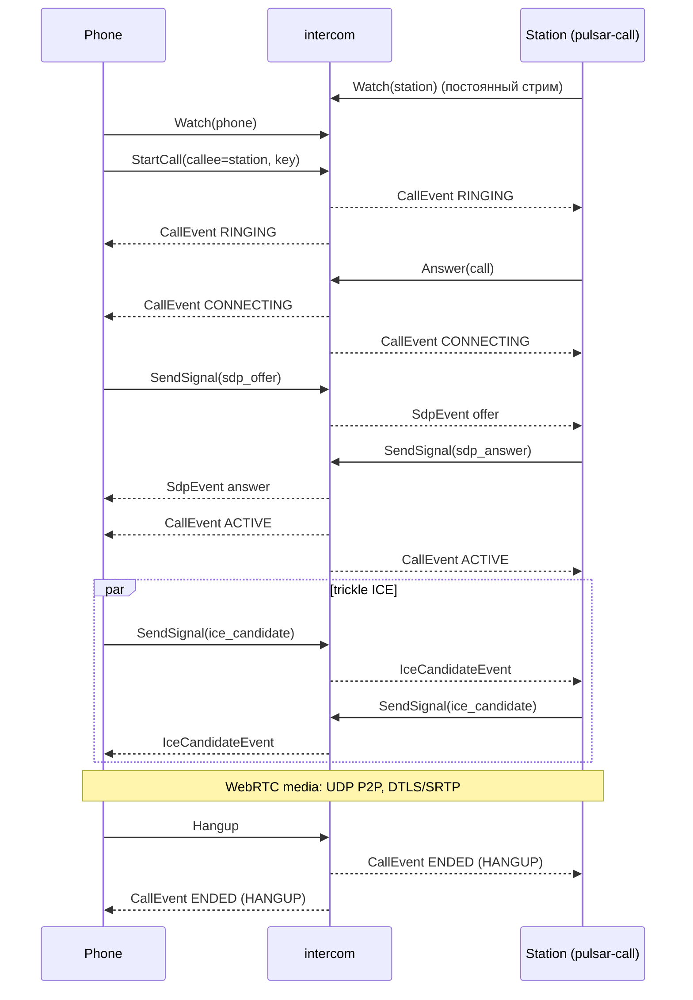

# intercom — сигналинг звонка телефон ↔ колонка

`home.v1.IntercomService` — сервис управления WebRTC-звонком. Медиа идёт
**напрямую** между телефоном и колонкой по UDP (DTLS/SRTP, Opus); этот сервис
не пересылает и не хранит звук, а только регистрирует endpoint'ы, ведёт
состояние звонка, релеит SDP/ICE и раздаёт события в `Watch`-стримы.

```
phone ──Connect/HTTP1.1──▶ intercom (K3s) ◀──Connect/HTTP1.1── station
   └────────────── WebRTC media: UDP, P2P ───────────────────┘
```

Решение и границы — `docs/DECISIONS.md` (48), контракт —
`packages/proto/home/v1/intercom.proto`, транспорт — `docs/GRPC.md`.

## Почему `Watch` + `SendSignal`, а не bidi

Android уже говорит Connect по HTTP/1.1 (JSON). Connect **server streaming**
работает по HTTP/1.1, а **bidi** требует HTTP/2. Поэтому события звонка идут
одним долгоживущим `Watch` server stream на endpoint, а исходящие SDP/ICE —
обычным unary `SendSignal`. Клиент не зависит от h2 и от WebSocket.

## API

| RPC | Тип | Назначение |
|---|---|---|
| `RegisterEndpoint` | unary | обновить `display_name`/`capabilities`; id/kind берутся из токена |
| `ListEndpoints` | unary | кто зарегистрирован и кто online |
| `StartCall` | unary | `callee_endpoint_id` + optional `idempotency_key` → `Call` в `RINGING` |
| `Answer` | unary | только callee, `RINGING` → `CONNECTING` |
| `Hangup` | unary | любой участник; причина выводится из состояния/роли |
| `GetCall` | unary | снимок для участника |
| `SendSignal` | unary | `oneof { sdp_offer, sdp_answer, ice_candidate, ice_end }` |
| `Watch` | **server stream** | события: incoming call, state, remote SDP, remote ICE, ICE end |
| `GetIceConfig` | unary | STUN/TURN из конфигурации; пусто = host candidates |
| `GetStatus` | unary | версия, online endpoint'ы, активные звонки, ready |

`WatchEvent`:

```text
oneof event {
  CallEvent          call          // снимок Call + previous_state
  SdpEvent           sdp           // call_id, from_endpoint_id, SdpSignal
  IceCandidateEvent  ice_candidate // call_id, from_endpoint_id, candidate
  IceEndEvent        ice_end
}
```

## Sequence



## Состояния и таймауты

```
RINGING --Answer(callee)--> CONNECTING --offer+answer--> ACTIVE
   |                            |                          |
   +-- 30 s --------------------+-- 20 s ------------------+-- max call -->
                                  любое живое состояние --Hangup/loss--> ENDED
```

- один живой звонок на endpoint; второй `StartCall` → `FAILED_PRECONDITION
  (busy)`;
- `caller == callee` → `INVALID_ARGUMENT`; неизвестный callee → `NOT_FOUND`;
  offline callee → `UNAVAILABLE`;
- ответить может только callee; offer — только caller, answer — только callee;
- `Hangup` во время `RINGING`: caller → `CANCELED`, callee → `DECLINED`;
  в `CONNECTING`/`ACTIVE` → `HANGUP`;
- истечение любого таймаута → `ENDED/TIMEOUT`;
- потеря последнего `Watch` endpoint'а завершает его живой звонок как
  `UNREACHABLE`;
- `ENDED` хранится 60 с (для `GetCall`/позднего `Hangup`) и затем удаляется;
  idempotency key освобождается вместе с записью. После рестарта состояние
  теряется — это осознанно: звонок эфемерный;
- `StartCall` идемпотентен по ключу: тот же callee возвращает исходный
  звонок, другой — `ALREADY_EXISTS`.

## Авторизация

- телефон — `Authorization: Bearer <app_token>`: тот же общий токен приложения,
  что scheduler/control (`Authorization: Bearer` в стиле scheduler);
- колонка — отдельный `station_token` (device secret);
- identity endpoint'а **выводится из токена**, поля `id`/`kind` в запросе
  игнорируются; `WatchRequest.endpoint_id` допустим только равный identity;
- неучастник звонка → `PERMISSION_DENIED`;
- токены читаются из `*_TOKEN` или `*_TOKEN_FILE`, не печатаются в логах и
  ошибках; SDP-тело не логируется (только направление и размер).

## Конфигурация

| Переменная | По умолчанию | |
|---|---|---|
| `INTERCOM_LISTEN` | `127.0.0.1:8099` | listener |
| `INTERCOM_TOKEN` / `_FILE` | — | phone bearer, общий токен приложения (обязателен) |
| `INTERCOM_STATION_TOKEN` / `_FILE` | — | station device token (обязателен) |
| `INTERCOM_PHONE_ENDPOINT_ID` | `phone` | identity телефона |
| `INTERCOM_STATION_ENDPOINT_ID` | `station` | identity колонки |
| `INTERCOM_RING_TIMEOUT_SECONDS` | `30` | RINGING |
| `INTERCOM_CONNECT_TIMEOUT_SECONDS` | `20` | CONNECTING |
| `INTERCOM_MAX_CALL_SECONDS` | `3600` | ACTIVE |
| `INTERCOM_ENDED_RETENTION_SECONDS` | `60` | хранение ENDED |
| `INTERCOM_STUN_URLS` | — | comma-separated STUN URLs |
| `INTERCOM_TURN_URLS`, `INTERCOM_TURN_USERNAME`, `INTERCOM_TURN_CREDENTIAL` | — | TURN (все три вместе) |

Пустой ICE-конфиг — это host candidates для LAN/VPN. Добавление TURN позже
не меняет контракт и клиентов.

## Health и метрики

- `GET /healthz` (liveness) и `/readyz` — plain `200 ok`;
- `GET /metrics` — Prometheus: `intercom_calls_started_total`,
  `intercom_calls_ended_total`, `intercom_signals_total`,
  `intercom_watch_opens_total`, `intercom_active_calls`,
  `intercom_endpoints_online`;
- `intercom -healthcheck` — loopback `/healthz` для distroless-образа;
- `intercom -status` — `GetStatus` phone-токеном.

## Тесты

```bash
cargo test -p intercom
bazelisk test //solutions/intercom/...
```

- state machine: ring → answer → active → hangup, оба таймаута, busy,
  hangup во время ringing, caller == callee, idempotency;
- `Watch` доставляет события обеим сторонам и маршрутизирует SDP/ICE только
  peer'у; drop последнего `Watch` завершает звонок;
- интеграционный тест поднимает настоящий Connect listener и проверяет
  unary + server-streaming по HTTP/1.1, неавторизованный запрос, чужой
  `endpoint_id`, `GetIceConfig`.

## Деплой

Манифесты — `projects/home/kubernetes/intercom/`, юнит CI — `intercom` в
`platform/ci/units.mjs`. Это полноценный deploy-юнит: PR CI собирает
`ghcr.io/proflyder/intercom` и публикует `tree-<hash>`; merge в `develop`
продвигает проверенный digest (`DEPLOY_NO_BUILD=1`, build-once) и катит
Deployment через `deploy.sh`. Откат — fix forward (`rollback.kind:
forward-only`): состояние звонков живёт только в памяти.

Секреты:

- OpenBao `secret/k8s/home-assistant/scheduler-auth` → `token`: общий токен
  приложения, ESO кладёт его в ключ `phone_token` секрета `intercom`;
- OpenBao `secret/k8s/home-assistant/intercom` → `station_token` (device
  secret, ≥32 случайных байта, не равен токену приложения);
- `secret/ci/deploy-home` → `intercom_env`: `INTERCOM_NODE_PORT` (30097);
- локальный `secrets/home/intercom.env` — только для ручного `deploy.sh`.

ESO-манифест применяется один раз:
`kubectl apply -f projects/home/kubernetes/intercom/manifests/external-secrets.yaml`.
HTTPS-имя `intercom.<домен>` описано в
`projects/home/kubernetes/ingress/manifests/routes.yaml` и появляется после
обычного деплоя ingress (`INTERCOM_HOST` вычисляется из `HOME_DOMAIN`).
NodePort закрыт host-фильтром `projects/home/kubernetes/scheduler/nft`:
источник — только LAN/VPN и pod CIDR.
